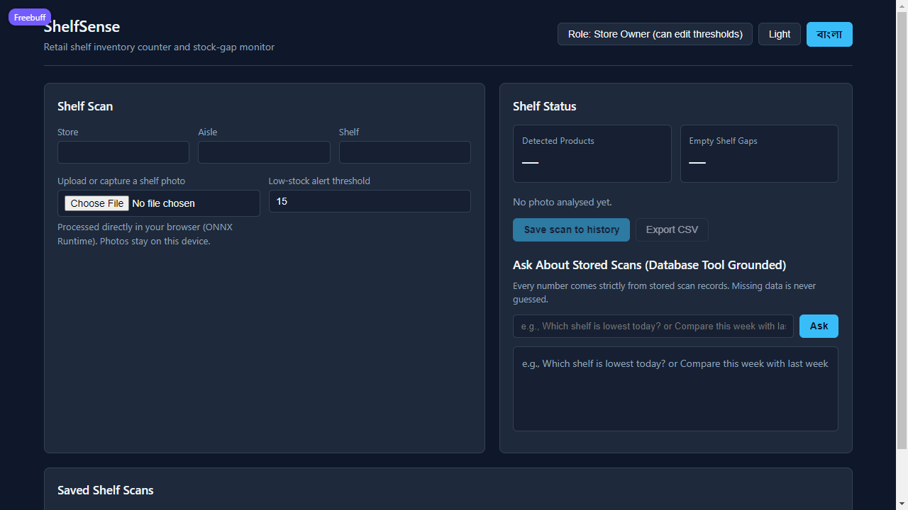

# ShelfSense

Count what is on a retail shelf from a single photo.

Live site: https://shelfsense-counter.vercel.app

> **Status: measured on validation and test.** The detector is a real fine-tuned torchvision FCOS
> ResNet-50 FPN model (BSD-3-Clause, 32.06M parameters), trained for 12 epochs on a Kaggle Tesla T4.
> On 200 SKU-110K test images it scores mAP50 **0.8418** with a count error of **21.3 %**; the
> browser runs the 32.8 MB INT8 graph. Every number below comes from an exported ONNX file scored
> with `pycocotools`, the commands are next to the numbers, and the prediction files are committed
> so anyone can rescore them. An earlier version of this repository published simulated accuracy
> figures; they were withdrawn and the full account is in [docs/LESSONS.md](docs/LESSONS.md).



## Goal

Take or upload a picture of a grocery shelf, find each product, count them, mark empty gaps and
flag low stock per store, aisle and shelf, with a chat that answers questions about stored scans
in English or Bangla.

## What a visitor can do today

- Upload a shelf photo or use the camera; the photo never leaves the device - the detector runs in
  the browser on ONNX Runtime (WASM), so there is no upload endpoint and no server inference.
- See the count, the empty-gap estimate, and the boxes drawn over the photo, then save the scan
  against store, aisle and shelf, export the history as CSV, and set a low-stock threshold.
- Ask the chat about stored scans in English or Bangla; it answers only from typed database tool
  results and refuses when the data is not there.
- Switch dark or light theme. The page shows real empty, loading and error states.

## Detector, measured on test and validation

Model: `fcos_resnet50_fpn` from torchvision, COCO-pretrained, fine-tuned for a single class
("item") on 6,036 images (6,009 SKU-110K + 27 CC0) for 12 epochs at 640 px.

**SKU-110K test, 200 images, 29,092 items, scored once** - thresholds fixed on validation first
(score 0.30, NMS 0.35, maxDets 1000):

| Model file | mAP50 | mAP50-95 | count MAE | count MAPE | ms/image (Kaggle CPU) |
| --- | --- | --- | --- | --- | --- |
| `fcos-r50-fpn-v3-int8.onnx` (32.8 MB) | 0.8418 | 0.4844 | 26.52 | 21.29 % | 1,055 |
| `fcos-r50-fpn-v3-fp32.onnx` (128.7 MB) | 0.8418 | 0.4851 | 26.55 | 21.30 % | 1,267 |

**SKU-110K validation, same 200-image size**: int8 mAP50 0.8524 / MAE 27.68, fp32 0.8602 / 27.68.
The sweep over score 0.15-0.30 and NMS 0.35/0.45 lived only on validation.

**CC0 Supermarket Shelves test, 9 images, 1,950 items, scored once** (a second retailer, the split
the browser measurement below was made on): int8 mAP50 0.7215, MAE 25.67, MAPE 19.91 %; fp32
0.7227, 26.56, 20.68 %. Nine images give a 95 % interval of mAP50 0.5324-0.8196, so this is a
coarse cross-store check, not a precise figure.

Produced by (prediction files are committed, so the numbers can be recomputed without the model):

```
# validation sweep, then one test pass - kernel ibrahimhossainsumon/shelfsense-fcos-eval, version 1
python training/eval_onnx.py \
  --onnx fcos-r50-fpn-v3-fp32.onnx fcos-r50-fpn-v3-int8.onnx \
  --dataset sku110k --split test --sku-dir /kaggle/input \
  --input-size 640 --normalise no --center-fix none \
  --score-thresh 0.30 --nms-thresh 0.35 --max-dets 1000 \
  --out docs/reports/sku110k-test.json --predictions-dir docs/reports/predictions
```

Raw JSON, intervals, density buckets and the per-image failures:
[docs/reports/test-evaluation.md](docs/reports/test-evaluation.md).

Reading the numbers honestly:

- **mAP50 0.84 means the boxes land on products, not that the count is right.** MAPE 21.3 % still
  means about one item in five is miscounted on an average shelf.
- **Sparse shelves are the failure case.** The one test image with under 50 items was counted at
  roughly four times the truth; the model always fires a packed-shelf number of candidates.
- **Density helps.** mAP50 is 0.778 on shelves with over 150 items (count error 12.8 %) against
  0.886 on 50-150 items (23.1 %).
- **INT8 costs nothing measurable** (0.0007 mAP50-95), which is why the browser ships the 32.8 MB
  file rather than the 128.7 MB reference export.
- **The trained domain is SKU-110K**, dominated by US, European and East Asian supermarkets;
  flexible pouches and hanging sachets common in South Asia are under-represented.

## What exists and works

- **Detector pipeline** (`training/`): leak-free dHash splits, annotation converters, resumable AMP
  training with a checkpoint every epoch, ONNX export with the normalisation and anchor geometry
  baked in, dynamic INT8 quantisation, evaluation through `pycocotools` (`maxDets=1000`) with
  bootstrap confidence intervals and density buckets, and a 20-image count regression bundle that
  CI scores on every push.
- **In-browser detection** (`apps/web/`): ONNX Runtime Web on WASM, box overlay, count, gap
  estimate. On the deployed site, `002.jpg` (690 items) took 3,996 ms and reported 663 products,
  against 657 from the Python fp32 path on the same image.
- **Dashboard** (English/Bangla, dark/light) with gap-from-spacing logic, CSV export, per-shelf saves
  and thresholds, all covered by unit tests (logic only, not detector accuracy).
- **Bilingual chat** with typed, user-scoped database tools: 30 questions (15 English, 15 Bangla)
  scored `30/30` tool selection and numeric grounding, `24/30` on the stricter verbatim check
  ([docs/reports/chat-eval-s5.md](docs/reports/chat-eval-s5.md)).
- **Python package and CLI** (`uv run shelfsense count photo.jpg`) sharing the browser's exact
  decoding, plus a FastAPI batch endpoint.
- **Repository hygiene**: one author, secret scanning, commit and push hooks, and CI that also
  exports a tiny FCOS to ONNX on CPU before any GPU run is pushed.

## Architecture

```
photo ──► browser (Next.js, Vercel)
          │  client-side resize → 640×640 stretch
          │  onnxruntime-web (WASM; the quantised graph declares webgpu_capable: false)
          │      FCOS R50-FPN → [1, N, 6] candidates
          │      score threshold → NMS → cap 1000 → count
          ├── box overlay + per-shelf save ──► Neon Postgres (Drizzle), thumbnail via Cloudinary
          └── chat ──► typed tools ──► the same database (numbers only from tool results)

training (Kaggle T4) ──► checkpoint every epoch ──► ONNX FP32 + INT8 ──► GitHub Release
                               └── pycocotools on validation, test once
```

## Layout

| Path | What |
| --- | --- |
| `apps/web/` | Next.js app: capture, in-browser detection, history, chat |
| `python/` | `shelfsense` package, CLI and FastAPI app |
| `training/` | dataset scripts, training, ONNX export and evaluation |
| `scripts/` | repo tooling, hooks logic, CI checks, `check-done.mjs` |
| `docs/` | state, decisions, data card, model card, reports |

## Licences

- Code: MIT ([LICENSE](LICENSE)).
- Detector: torchvision FCOS, BSD-3-Clause, including the COCO-pretrained backbone weights.
- SKU-110K: academic and non-commercial research use only, so weights fine-tuned on it carry
  that restriction and the published model is a research and portfolio artefact.
- Supermarket Shelves (Humans in the Loop): CC0 1.0 public domain.

Details: [docs/DATA.md](docs/DATA.md), [docs/MODEL_CARD.md](docs/MODEL_CARD.md).
