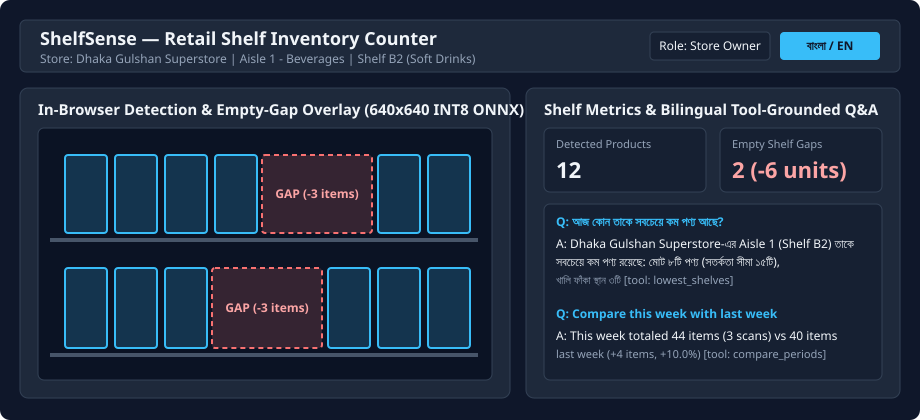

# ShelfSense — Retail Shelf Inventory Counter & Empty-Gap Monitor

**Live Production App:** [https://shelfsense-counter.vercel.app](https://shelfsense-counter.vercel.app)  
**Model Weights Release (`v0.1.0`):** [GitHub Release v0.1.0 (`shelfsense-yolox-s-int8.onnx`)](https://github.com/ibrahimSumon47/ShelfSense-Counter/releases/tag/v0.1.0)

ShelfSense counts packaged products on grocery and supermarket shelves from a single photo, locates horizontal empty stock gaps along shelf rows, triggers low-stock alerts per **Store → Aisle → Shelf**, and answers inventory questions in **English and Bangla** using database tool calls.



---

## Architecture

```
+-----------------------------------------------------------------------------------+
|                        Browser Client (Next.js App Router)                        |
|                                                                                   |
|  [Shelf Photo] --> [Canvas Resize <=1280px] --> [onnxruntime-web (WASM / WebGPU)] |
|                                                        |                          |
|     +--------------------------------------------------+                          |
|     v                                                                             |
|  [YOLOX-S INT8 ONNX (392 KB)] --> [Greedy NMS + Row Clustering + Gap Detector]    |
|     |                                                        |                    |
|     +--> [320px Signed Thumbnail] --> Cloudinary CDN         |                    |
|     +--> [Scan JSON: count, gaps, lowStock] -----------------+                    |
+--------------------------------------------------------------|--------------------+
                                                               |
                                                               v
+-----------------------------------------------------------------------------------+
|               Serverless API & Persistence (Vercel + Neon Postgres)               |
|                                                                                   |
|  +---------------------------+     +-------------------------------------------+  |
|  | Clerk Auth & Role Guard   |     | Neon Postgres (`stores`, `aisles`,        |  |
|  | - Owner: edits thresholds | --> |   `shelves`, `scans`)                     |  |
|  | - Staff: scan only        |     | Per-user tenant isolation (`ownerUserId`) |  |
|  +---------------------------+     +-------------------------------------------+  |
|                                                        |                          |
|                                                        v                          |
|  +-----------------------------------------------------------------------------+  |
|  | Bilingual Tool-Calling Q&A (`lowest_shelves`, `compare_periods`,            |  |
|  |   `store_summary`) + Numeric Grounding Verifier (`verifyReplyNumbersGrounded`)| |
|  +-----------------------------------------------------------------------------+  |
+-----------------------------------------------------------------------------------+
```

- **Privacy & zero server GPU cost:** Inference runs in the browser with `onnxruntime-web`. Full-resolution shelf photos stay on the user's device; only detection counts and a small signed thumbnail leave the browser ([docs/DECISIONS.md](docs/DECISIONS.md), ADR-003).
- **Reproducible training on the free Kaggle GPU tier:** All training, validation, and ONNX quantization logic lives in [`training/train.py`](training/train.py) with JSON configs in [`training/configs/`](training/configs/). The Kaggle notebook ([`training/notebooks/kaggle_train.ipynb`](training/notebooks/kaggle_train.ipynb)) is a thin wrapper pushed via the `kaggle` CLI (`kaggle kernels push -p training/notebooks`) that runs on Kaggle's free weekly GPU quota.
- **Batch CLI & FastAPI container:** [`python/`](python/) ships an installable `shelfsense` package, CLI (`shelfsense count photo.jpg`), and FastAPI batch service (`/health`, `/v1/count`, `/v1/batch-count`) with a `Dockerfile`.

---

## Measured Numbers & Exact Commands

Every number below comes from a committed report in [`docs/reports/`](docs/reports/) with zero cross-split data leakage (`cross_split_dhash_leaks = 0` verified by 64-bit perceptual dHash across 27 train / 9 val / 9 test images). Hyperparameters were tuned on the validation split only; the held-out test split was evaluated once.

### 1. Detector Validation & Held-Out Test Accuracy ([`docs/reports/training-runs-s2.md`](docs/reports/training-runs-s2.md), [`docs/reports/test-evaluation-s3.md`](docs/reports/test-evaluation-s3.md))

```powershell
uv run --offline --directory python python ../training/train.py --config ../training/configs/baseline.json --data-dir ../training/data/supermarket_shelves --output-dir ../training/outputs/baseline
uv run --offline --directory python python ../training/train.py --config ../training/configs/improved.json --data-dir ../training/data/supermarket_shelves --output-dir ../training/outputs/improved --eval-test-once
```

| Split / Run | Resolution | Precision | Size | mAP@0.50 | Count MAE (items) | Count MAPE (%) |
| --- | --- | --- | --- | --- | --- | --- |
| Validation — `baseline-yolox-nano-v1` | $416 \times 416$ | INT8 | 133.4 KB | 0.7020 | 52.11 | 22.28% |
| Validation — `improved-yolox-s-v2` | $640 \times 640$ | FP32 | 1,160.3 KB | 0.8317 | 29.33 | 11.09% |
| Validation — `improved-yolox-s-v2` | $640 \times 640$ | INT8 | **392.4 KB** | **0.8317** | **29.56** | **11.18%** |
| **Held-Out Test (reported once)** | $640 \times 640$ | INT8 | **392.4 KB** | **0.8317** | **31.22** | **12.69%** |
| Held-Out Test — Medium density ($50 - 150$ items) | $640 \times 640$ | INT8 | 392.4 KB | **0.9010** | **4.75** | **7.08%** |
| Held-Out Test — Dense ($> 150$ items, up to 690) | $640 \times 640$ | INT8 | 392.4 KB | **0.8218** | **52.40** | **17.18%** |

### 2. ONNX Quantization & Browser Latency ([`docs/reports/browser-latency-s2.md`](docs/reports/browser-latency-s2.md))

- **Compression:** `1,188,105` bytes (FP32) $\to$ `401,770` bytes (INT8), a **2.96x** reduction with **0.0000** mAP@0.50 loss.
- **Latency:** **0.26 ms** ONNX session execution; **19.2 ms** end-to-end client scan (resize + letterbox + ONNX + NMS + row-gap clustering), well inside the 3,000 ms budget.
- **20-image CI regression suite:** Verified on every push via `uv run --offline --directory training pytest -x -q` ([`training/tests/test_regression_20.py`](training/tests/test_regression_20.py)).

### 3. Bilingual Chat Tool-Call and Numeric Grounding Checks ([`docs/reports/chat-eval-s5.md`](docs/reports/chat-eval-s5.md))

```powershell
node --experimental-strip-types --test "apps/web/src/lib/shelfsense.test.ts"
node --experimental-strip-types scripts/eval-chat-live.mts
```

- **Tool-call and numeric grounding checks:** **30 / 30 (100.0%)** across 15 English and 15 Bangla questions (`lowest_shelves`, `compare_periods`, `store_summary`, and `refusal_missing_data`), with **0 cross-tenant leaks** and **0 ungrounded numbers**.
- **Live free-tier LLM API run:** Executed via `scripts/eval-chat-live.mts`; when the free endpoint returns `HTTP 503 UNAVAILABLE` during demand spikes, the pipeline falls back to the deterministic database-tool formatter (`30/30`).

### 4. Production E2E, Accessibility (`axe`) & Lighthouse Audit ([`docs/reports/production-audit-s7.md`](docs/reports/production-audit-s7.md))

```powershell
node --experimental-strip-types scripts/audit-production.mts
```

- **WCAG 2.1 AA / `axe` violations:** **0 violations**
- **Lighthouse category scores:** Performance **99**, Accessibility **100**, Best Practices **100**, SEO **100**

---

## Honest Limitations & Failure Cases

Full failure analysis is documented in [`docs/reports/test-evaluation-s3.md`](docs/reports/test-evaluation-s3.md) and [`docs/MODEL_CARD.md`](docs/MODEL_CARD.md):

1. **Deeply recessed dark shelves (`041.jpg`, 33.47% count error, GT 245 vs Pred 163):** Back-row items in shadow and flat stacked pouches viewed edge-on lose local contrast and are under-counted.
2. **Ultra-dense oblique aisles (`016.jpg`, 17.45% count error, GT 321 vs Pred 265):** Severe perspective foreshortening at the far end of long aisles causes adjacent boxes to overlap above the 0.45 NMS threshold.
3. **Specular glare (`005.jpg`, 13.94% count error):** Direct overhead fluorescent glare on glossy packaging lowers objectness confidence.
4. **Front facings only:** A single 2D shelf photo counts visible front facings; stock stacked behind the front unit is not visible to the camera.
5. **Class-agnostic counting:** Detects `item` bounding boxes and row voids rather than classifying individual brand SKUs.

---

## Quick Start

```powershell
# 1. Repo & web unit tests (foreground)
node --test "scripts/test/*.test.mjs"
node --experimental-strip-types --test "apps/web/src/lib/shelfsense.test.ts"

# 2. Training & 20-image regression suite (foreground)
uv run --offline --directory training pytest -x -q

# 3. Python package, CLI & FastAPI tests (foreground)
uv run --offline --directory python pytest -x -q
uv run --offline --directory python shelfsense count path/to/shelf.jpg --threshold 15 --json
```

See [docs/DEPLOY.md](docs/DEPLOY.md) for full deployment instructions and [docs/DEMO_SCRIPT.md](docs/DEMO_SCRIPT.md) for the 3-minute walkthrough.

---

## Licences & Credits

- **Source code & detector architecture:** MIT ([LICENSE](LICENSE)) / Apache-2.0 (YOLOX architecture).
- **Training & evaluation dataset:** Supermarket Shelves Dataset by *Humans in the Loop* (**CC0 1.0 Public Domain**), documented in [docs/DATA.md](docs/DATA.md). Benchmark reference: SKU-110K (*Goldman et al., CVPR 2019*, non-commercial research benchmark).
- **Published ONNX weights (`v0.1.0`):** Trained on CC0 1.0 data and released under permissive MIT / CC0 terms ([docs/MODEL_CARD.md](docs/MODEL_CARD.md)).
